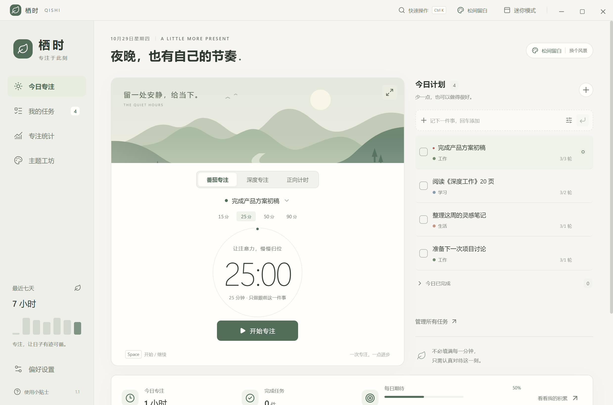
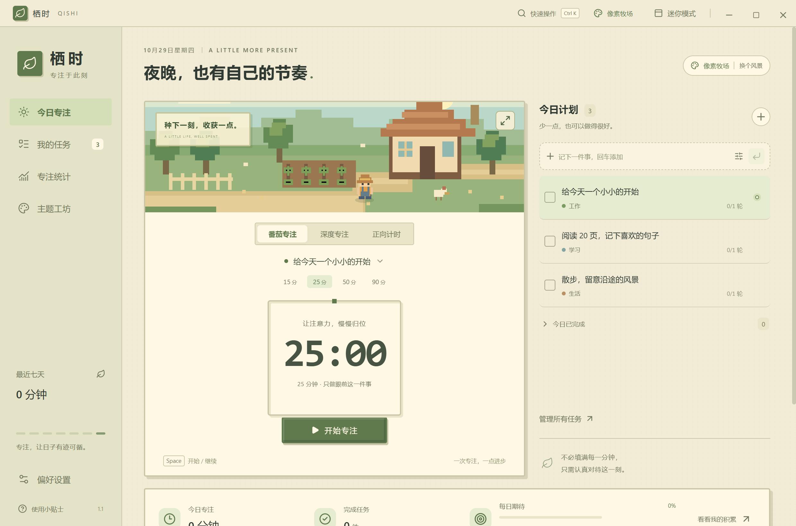

# 栖时 · QISHI

一个离线可用的 Windows 桌面专注工具。1.1 版带来五个原创视觉世界，以及更顺手的任务安排、专注环境音和复盘。

**[下载安装版](https://github.com/mingrifeibai/qishi-focus/releases/latest)** · [安装与分享说明](docs/INSTALLATION.md) · [验证报告](docs/TEST_REPORT.md)

普通用户请在 Releases 下载 `Qishi-Setup-1.1.0-x64.exe`，双击即可安装并创建桌面快捷方式。GitHub 的「Code → Download ZIP」下载的是源码，不包含可执行程序。

## 直接使用

**推荐安装版**：双击 `release/Qishi-Setup-1.1.0-x64.exe`，自动安装到当前 Windows 用户下，创建「栖时」桌面快捷方式和开始菜单入口，完成后启动程序。分享给别人只需发送这一个 EXE 文件，对方不需要源码、Node.js 或联网下载运行环境。

**免安装版**：双击 `release/Qishi-1.1.0.exe`，或者项目根目录的 `启动栖时.cmd`。旧版任务、记录和备份可以直接沿用。安装版与免安装版使用同一应用数据位置。

安装版可通过 Windows「设置 → 应用」卸载，默认保留个人数据。再次运行安装包可重新安装同一版本。当前安装包未配置数字签名，Windows 可能显示未知发布者。完整说明见 `docs/INSTALLATION.md`。

第一次打开是干净的任务列表。先添加一件事，选中任务，点击「开始专注」。也可以直接开始自由专注。

> `docs/screenshots/` 中的截图使用独立测试数据展示界面。示例任务和统计没有写入正式用户数据。



## 1.1：换个世界，继续专注

在侧栏「主题工坊」选择主题；顶部的主题名称也可直达。场景、配色、字体、按钮和边框一起变化，每套主题都支持浅色、深色与跟随系统。

| 主题     | 风格                               |
| -------- | ---------------------------------- |
| 松间留白 | 暖白、松绿、远山与留白             |
| 霓虹都市 | 赛博城市、青紫霓虹、夜行列车       |
| 积木工坊 | 奶油色、立体积木、玩具小人         |
| 烟雨江湖 | 宣纸、水墨山峦、扁舟与朱砂         |
| 像素牧场 | 像素小人、农舍、田野与成长中的作物 |



场景均为原创 SVG，不需要下载素材。可在主题工坊关闭场景动效和专注伙伴；系统的减少动态效果偏好也会生效。

### 更顺手的日常使用

- **一句话添加**：输入 `明天 阅读 20 页 #学习 !重要`，回车即保存。日期词、已有分类名和优先级用空格分隔；支持今天、明天、后天、收集箱。普通文本原样保留。
- **批量安排**：在我的任务点击「批量安排」，多选后一起移到今天、明天或收集箱，也可一起完成。
- **重复任务**：支持每天、工作日、每周。完成当前任务时生成下一项；工作日跳过周末，错过的日期不会堆出一串历史任务。撤销完成再完成不会重复生成下一项。
- **任务模板**：阅读、写作、学习带有可编辑的子步骤与预计轮数。
- **快速操作**：`Ctrl + K` 搜索待办并选为专注任务，也可跳转主题、统计和任务页；方向键选择，回车确认。
- **时长预设**：15、25、50、90 分钟一键切换；专注进行中保留当前时长。
- **环境音**：雨幕、白噪音、棕噪音，在本地实时合成，可调音量；只在专注运行时播放，暂停、结束和休息时自动静音。
- **专注伙伴**：按实际已记录的累计专注时长显示成长进度；不设断签惩罚，也不要求连续打卡。
- **一句复盘**：结束后记录下一步，点击「保存复盘」。笔记会出现在历史记录，并进入 JSON 备份与 CSV 导出。

## 已实现

- **任务**：创建、编辑、完成、恢复、删除与撤销；分类、计划日期、优先级、预计轮数、备注、子任务；搜索、排序、收集箱、计划与完成列表。
- **专注**：番茄倒计时、深度倒计时、正向计时；暂停、继续、提前结束并记录、放弃不记录；自由专注、任务关联、沉浸视图。
- **休息**：短休息、按完成轮数提供长休息；提示音、桌面通知；任务完成由使用者决定。
- **统计**：日／周／月时长趋势、分类分布、已完成任务、有效专注次数、月度专注日历、历史记录、CSV 导出；跨午夜的专注按实际时间分配。
- **桌面**：可置顶的迷你窗口、托盘、单实例、最小化／最大化、窗口内快捷键、系统主题跟随。
- **数据**：本地持久化、原子写入、上一份自动备份、JSON 导入／导出、恢复前额外备份、损坏文件保留与自动回退。
- **交互细节**：未保存修改保护、空状态、长文本省略、删除任务保留历史、弹窗键盘焦点约束、减少动态效果偏好支持。

## 计时规则

- 计时由 Electron 主进程管理。切换页面、最小化或收进托盘不会中断计时。
- 暂停、休息、应用退出期间不计入专注。电脑休眠时自动暂停；重启后恢复为暂停状态。
- 超过 10 秒的调度间隔或系统时间回退会触发暂停保护，避免将休眠时间误记为专注。
- 正常结束倒计时只生成一条记录；提前结束保留实际专注时间；不足 1 秒和主动放弃不会生成记录。
- 统计以已结束的专注记录为准，正在进行的一轮会在结束后进入统计。
- 正向计时单轮最长 24 小时，到达上限自动记录。
- 运行中的状态约每 2.5 秒落盘；操作与正常退出立即保存。进程被强制终止时，最多可能缺少最后一个保存周期的进度。

## 快捷键

| 操作               | 快捷键             |
| ------------------ | ------------------ |
| 添加任务           | `Ctrl + N`         |
| 搜索任务／快速操作 | `Ctrl + K`         |
| 开始、暂停或继续   | `Space`            |
| 迷你窗口           | `Ctrl + Shift + M` |
| 关闭弹窗／退出沉浸 | `Esc`              |

快捷键在栖时窗口内生效；在输入框中输入空格不会触发计时。

## 数据位置与备份

正式数据位于 Windows 用户数据目录中；请以「偏好设置 → 数据，留在你这里」展示的实际路径为准，旁边的文件夹按钮可以直接打开。

- `qishi-data.json`：当前数据。
- `qishi-data.json.bak`：上一份自动保存记录。
- `before-restore-*.json`：恢复外部备份前保留的当前数据。
- `.damaged-*` / `.unreadable-*`：无法读取时保留的原始文件。

数据不依赖程序所在目录，但更换电脑时需要在设置中导出 JSON 备份，并在新电脑恢复。CSV 是可供 Excel 阅读的统计导出，不能代替完整备份。恢复 JSON 会替换当前任务、统计和偏好设置；应用会先提示确认并保留恢复前的数据。

## 开发与构建

当前锁定依赖和验证环境见 `package-lock.json`。本次开发使用 Node.js 24，Windows x64。

```powershell
npm.cmd ci
node node_modules/electron/install.js
npm.cmd run build
npm.cmd start
```

浏览器预览：

```powershell
npm.cmd run dev
```

浏览器预览使用独立的浏览器本地存储。托盘、真正的窗口置顶、系统休眠事件和原生文件对话框需在桌面版中使用。

验证与打包：

```powershell
npm.cmd test
npm.cmd run test:e2e
npm.cmd run package
npm.cmd run package:portable
```

`package` 生成一键安装版，`package:portable` 生成免安装版。`test:e2e` 启动真实 Electron 窗口，在 `.test-data/` 下使用隔离数据。运行前需先执行 `npm.cmd run build`。测试截图会写入 `docs/screenshots/`。Windows 的通知展示还取决于系统通知权限与免打扰设置。

`npm.cmd run verify:installer` 会检查机器上没有既有安装；若有免安装版运行，还会确认安装器能按安装路径隔离进程检查，再执行临时安装、实际快捷方式校验、安装后启动、重复安装和卸载测试。临时程序与隔离数据位于 `.test-data/`；测试结束移除测试安装与注册信息，恢复原有同名快捷方式，检查原有进程仍在运行，保留验证数据。仅在适合执行安装测试的 Windows 环境运行。

## 项目结构

```text
src/                 React 界面、共享领域逻辑、浏览器预览桥接
electron/            桌面窗口、计时循环、IPC、本地文件保存
assets/              应用图标
scripts/             图标生成与发行验证工具
tests/               领域逻辑与真实桌面流程测试
docs/                设计、迭代记录、测试报告与截图
dist/                编译后的前端（构建生成，不提交）
dist-electron/       编译后的桌面代码（构建生成，不提交）
release/             当前安装版、免安装版与校验值（通过 Releases 分发）
```

前端与桌面共用 `src/core.ts`，计时规则和统计规则只有一份。主窗口使用隔离预加载桥接，界面无法直接访问 Node.js 文件 API。界面素材为项目内原创 SVG 与本地图标，不依赖远程图片、字体或 CDN。

实现参考：[Electron 隔离上下文](https://www.electronjs.org/docs/latest/tutorial/context-isolation)、[电源与休眠事件](https://www.electronjs.org/docs/latest/api/power-monitor/)、[electron-builder Windows 发行目标](https://www.electron.build/v26/docs/targets/)。
